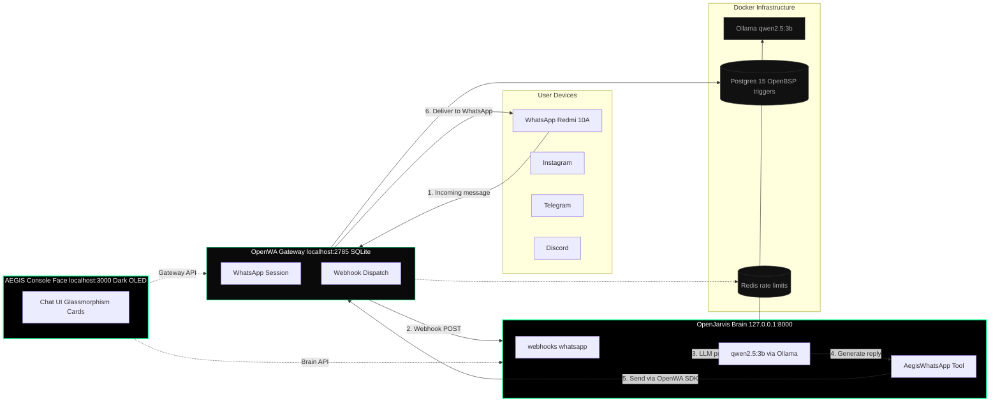

# AEGIS-OS

<div align="center">

  <picture>
    <source media="(prefers-color-scheme: dark)" src="./console/public/logo.svg" />
    
  </picture>

  <h1>AEGIS-OS</h1>
  <p><b>One OS to control WhatsApp, Instagram, Telegram, Discord — all devices.</b></p>
  <p>
    <i>Local-first AI operating system with an obsidian glass shield core.</i>
  </p>

  <p>
    
    
    
    
    
    
  </p>

  <p>
    <b>BRAIN</b> OpenJarvis · Local-first AI · 5 primitives · <i>jarvis serve</i> on 127.0.0.1:8000 · WhatsApp, Telegram, Discord channels
  </p>
  <p>
    <b>GATEWAY</b> OpenWA · WhatsApp API Gateway · REST + Dashboard on localhost:2785 · Multi-session · SQLite mode
  </p>
  <p>
    <b>CONSOLE</b> AEGIS · Dark OLED face · Glassmasonry UI · Points to gateway:2785 + brain:8000
  </p>

</div>

---

## Architecture


    class Brain brain
    class OLL,DB,REDIS infra
```

### Message flow

```
WhatsApp Message (Redmi 10A)
        │
        ▼
OpenWA Gateway (gateway:2785)
        │  Webhook POST
        ▼
OpenJarvis Brain (brain:8000/webhooks/whatsapp)
        │  Agent processes with local LLM (qwen2.5:3b)
        ▼
aegis_whatsapp_send tool (rmyndharis-openwa SDK)
        │  Reply via OpenWA SDK
        ▼
OpenWA Gateway → WhatsApp → Redmi 10A
        │
        ▼
AEGIS Console (console:3000) displays conversation
```

---

## Features

| Layer | Capability |
|-------|-----------|
| **Brain** (OpenJarvis) | Local-first AI framework with 5 primitives (Intelligence, Engine, Agents, Tools/Memory). Runs `jarvis serve` on `127.0.0.1:8000`. Supports WhatsApp, Telegram, Discord channels. |
| **Gateway** (OpenWA) | WhatsApp API Gateway with REST API + Dashboard on `localhost:2785`. Multi-session, ~300MB per session. SDKs: `@rmyndharis/openwa` (JS) and `rmyndharis-openwa` (Python). SQLite mode for low-resource hardware. |
| **Console** (AEGIS) | Dark OLED (#000000) face with glassmorphism cards, obsidian glass shield logo, network-core animation. No light mode. Points to gateway:2785 + brain:8000. |
| **Orchestration** | Docker Compose glue: brain, gateway, console, ollama, postgres, redis on a shared `aegis` network. |
| **Messaging** | WhatsApp → OpenWA → Webhook → Brain → LLM → OpenWA SDK reply → Gateway → WhatsApp → Console display. |

---

## Hardware target

AEGIS-OS is optimized for modest hardware:

- **CPU:** Intel i7-7500U (2 cores / 4 threads)
- **RAM:** 16 GB
- **GPU:** 2 GB
- **Test device:** Redmi 10A

To stay within these limits:

- **Model:** `qwen2.5:3b` (tiny, runs on 2GB GPU via Ollama)
- **Database:** SQLite for OpenWA (not Postgres-heavy)
- **Memory cap:** 2 GB per container
- **PID cap:** 2048 per container

---

## Quick start

```bash
# 1. Clone the monorepo
git clone https://github.com/YOUR_USERNAME/AEGIS-OS.git
cd AEGIS-OS

# 2. Configure environment
cp .env.example .env
# Edit .env if needed (AEGIS_SESSION_ID, API keys, etc.)

# 3. Launch
docker compose up -d
```

Services come up on:

| Service | URL |
|---------|-----|
| AEGIS Console | http://localhost:3000 |
| OpenWA Gateway (API + Dashboard) | http://localhost:2785 |
| OpenJarvis Brain | http://127.0.0.1:8000 |
| Ollama (LLM) | http://localhost:11434 |

### First-time setup

1. Open the Gateway dashboard at **http://localhost:2785**
2. Create a WhatsApp session and scan the QR code with your phone
3. Copy the admin API key from the container logs:
   ```bash
   docker exec aegis-gateway cat /app/data/.api-key
   ```
4. Set `AEGIS_API_KEY` and `AEGIS_SESSION_ID` in `.env` to match your session
5. Restart: `docker compose restart brain`
6. Open the Console at **http://localhost:3000** and start messaging

---

## Wiring

| Connection | Direction | Purpose |
|------------|-----------|---------|
| Gateway → Brain | `WEBHOOK_URL=http://brain:8000/webhooks/whatsapp` | Inbound WhatsApp messages forwarded to the brain |
| Brain → Gateway | `aegis_whatsapp_send` tool via `rmyndharis-openwa` SDK | Outbound WhatsApp replies sent through the gateway |
| Console → Gateway | `VITE_GATEWAY_URL=http://gateway:2785` | Console talks to gateway REST API |
| Console → Brain | `VITE_BRAIN_URL=http://brain:8000` | Console talks to brain API |
| Brain → Ollama | `OLLAMA_HOST=http://ollama:11434` | Local LLM inference |

### Brain: `src/openjarvis/tools/aegis_whatsapp.py`

Uses the `rmyndharis-openwa` Python SDK (`OpenWAClient`) to send WhatsApp replies back through the OpenWA gateway after the brain processes an inbound webhook.

```python
from openwa import OpenWAClient
client = OpenWAClient(base_url="http://gateway:2785", api_key="aegis_master_key")
client.messages.send_text(session_id, {"chatId": "1234567890@c.us", "text": "Hello from AEGIS"})
```

### Gateway: `.env`

```
WEBHOOK_URL=http://brain:8000/webhooks/whatsapp
SSRF_ALLOWED_HOSTS=brain
DATABASE_TYPE=sqlite
```

### Console: `.env`

```
VITE_GATEWAY_URL=http://gateway:2785
VITE_BRAIN_URL=http://brain:8000
VITE_APP_NAME=AEGIS
```

---

## Repo layout

```
AEGIS-OS/
├── /brain       OpenJarvis — local-first AI (port 8000)
├── /gateway     OpenWA — WhatsApp API Gateway (port 2785)
├── /console     AEGIS — dark OLED console (port 3000)
├── docker-compose.yml
├── .env.example
└── README.md
```

---

## Licenses

| Component | License | Origin |
|-----------|---------|--------|
| Brain (OpenJarvis) | Apache 2.0 | open-jarvis/OpenJarvis |
| Gateway (OpenWA) | MIT | rmyndharis/OpenWA |
| Console (AEGIS) | The Unlicense | matiasbattocchia/open-bsp-ui (rebranded) |
| AEGIS-OS glue | MIT | This repo |

---

## Disclaimer

OpenWA connects to WhatsApp through reverse-engineered clients (whatsapp-web.js / Baileys), **not** Meta's official Cloud API. There is a non-zero risk of account restriction or ban. Use a dedicated number you can afford to lose. AEGIS-OS is for personal, self-hosted use — not regulated or commercial WhatsApp automation.
