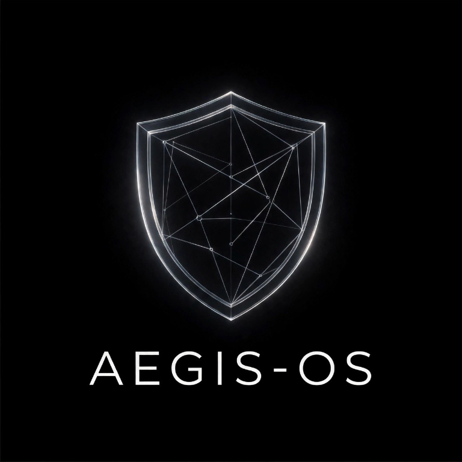
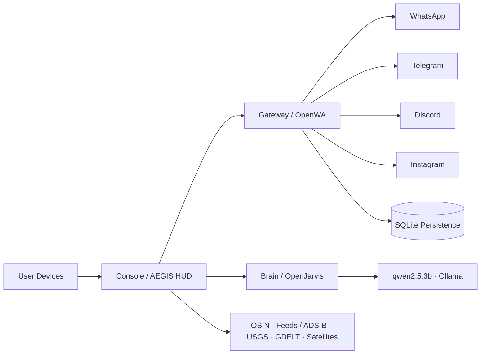

<div align="center">




<h1>AEGIS-OS</h1>

<p><b>One OS to control WhatsApp, Instagram, Telegram, Discord — all devices.</b></p>
<p><i>Local-first AI operating system with an obsidian glass shield core.</i></p>

<p>
  
  
  
  
  
  
  
  
</p>

</div>

---

## ⚡ What is AEGIS-OS?

AEGIS-OS is a **local-first AI operating system** that turns a modest machine into a tactical command console: messaging across WhatsApp, Telegram, Instagram and Discord, a live OSINT world map, and a self-hosted AI brain — all running on your own hardware, no cloud required.

| ⚡ Feature | 🛡️ Capability |
|-----------|---------------|
| 🧠 **Brain (OpenJarvis)** | Local AI framework with 5 primitives — Intelligence, Engine, Agents, Tools, Memory. Serves a local LLM (`qwen2.5:3b` via Ollama). |
| 📡 **Gateway (OpenWA)** | WhatsApp API gateway — REST API + dashboard, multi-session, SQLite mode, QR pairing. |
| 🖥️ **Console (AEGIS)** | Dark OLED HUD (`#050A0E` / cyan `#8AF8FF`), glassmasonry panels, animated tactical UI. |
| 🌍 **World View** | Searchable 2D / 3D / satellite map with saved layers, GeoJSON drawing/export, OSRM driving directions, terrain relief, public GTFS-RT transit in supported regions, Open-Meteo wind vectors, NOAA satellite cloud and water-vapor imagery, selectable and animatable RainViewer radar frames, solar day/night shading, 3D buildings, and live ADS-B, USGS, satellite, NASA fire, GDELT, weather and NOAA weather-alert overlays. |
| 💬 **Social Hub** | **AEGIS WhatsApp** embedded — scan a QR, chat in the HUD. Plus Telegram / Instagram / Discord connectors. |
| 🗞️ **News & Conflict** | GDELT global events with country search, recommendations and a live mini-map. |
| 🔋 **Memory** | Persistent everywhere — IndexedDB in the console, SQLite in the gateway. Sessions survive restarts. |
| ✈️ **Offline-first** | Feeds degrade gracefully; the console keeps running without internet. |

### AEGIS WhatsApp

The WhatsApp panel uses the linked WhatsApp session and local AEGIS SQLite/media storage. It supports chat and message search, direct/group/channel filters, text replies, forwarding, reactions and deletion, attachment sending and downloads, group creation, typing indicators, and WhatsApp voice/video call links. Uploads are streamed to disk and support files up to 2 GB.

Direct WhatsApp voice/video calling and Status-story creation are not exposed by the current linked-device adapter; call links can be generated and shared instead. Availability of synced history and media depends on what WhatsApp provides to the linked session.

### AI Studio online models

AI Studio keeps its local Ollama models available and adds optional NVIDIA NIM and Groq chat models. The **FREE-SEARCH // TAVILY + LLAMA - Perplexity Clone 🌐 FREE** option searches Tavily and summarizes results with NVIDIA. Add keys through **AI Studio → API KEYS** or configure server-side variables in the repository-root `.env.local`, `.env`, or `gateway/.env.local`: `NVIDIA_API_KEY`, `GROQ_API_KEY`, `OPENROUTER_API_KEY`, and `TAVILY_API_KEY`. Use [.env.local.example](./.env.local.example) as the template for a root `.env.local`. Browser-entered keys stay in that browser's local storage and provider requests go through the local gateway. Do not use `VITE_`-prefixed provider secrets because Vite embeds those values in browser bundles. If NVIDIA's account inference route is unavailable, AI Studio falls back to local Ollama; Tavily search still returns the retrieved answer or source text.

---

## 🏗️ Architecture



---

## 🧰 Tech Stack

<p>
  
  
  
  
  
  
  
  
  
  
</p>

---

## 🚀 Quick Start

```bash
git clone https://github.com/emmadleo9/AEGIS-OS.git
cd AEGIS-OS
npm run start        # one coordinator boots gateway (2785) + console (5173)
# Windows: run "MASTER START AEGIS-OS V.04.bat"
```

Then open **http://localhost:5173** — the AEGIS HUD. The master launcher checks Node.js and dependencies, reuses Ollama if running (or starts it when installed), starts the gateway first, waits for its WhatsApp/API health checks, then starts the Vite console and verifies its gateway proxy. Repeated starts reuse the existing healthy stack rather than creating duplicate servers. Use [STOP-AEGIS.bat](./STOP-AEGIS.bat) to stop launcher-owned processes. The gateway stays on its internal port and the Vite server proxies `/api`, `/gateway`, and `/v1` through the console origin. Pair AEGIS WhatsApp from the Social Hub by scanning the QR with your phone.

The Windows master launcher and `npm run start` use the same local gateway + console stack. Do not start the Docker Compose stack at the same time: it publishes conflicting gateway/console ports and is a separate deployment configuration.

---

## 📁 Repo Layout

```
AEGIS-OS/
├── /brain       OpenJarvis — local-first AI brain
├── /gateway     OpenWA + AEGIS feeds — local API gateway
├── /console     AEGIS — dark OLED HUD console
└── README.md
```

---

## 📜 License

MIT — see [LICENSE](LICENSE).

---
Built with open-source. See CREDITS.md for licenses.

---

<div align="center">
<i>AEGIS-OS · obsidian glass shield core · status: ONLINE</i><br/>

</div>
